<div align="center">


# StajDesk

**Kurumsal çalışan portalı ve talep yönetim sistemi.**

Destek talepleri · envanter · çok adımlı onay akışları · 43 departman uygulaması · kurum içi iletişim — tek portalda, role göre.

[](https://github.com/toygarkeskin/StajDesk-New/actions/workflows/ci.yml)
[](https://github.com/toygarkeskin/StajDesk-New/releases)
[](backend)
[](frontend)
[](docker-compose.yml)
[](#hızlı-başlangıç)

[Hızlı başlangıç](#hızlı-başlangıç) · [Ekran görüntüleri](#ekran-görüntüleri) · [Neler çalışıyor](#neler-çalışıyor) · [Mimari](#mimari) · [Belgeler](docs/README.md) · [Katkı](CONTRIBUTING.md)

</div>

---

<p align="center">
  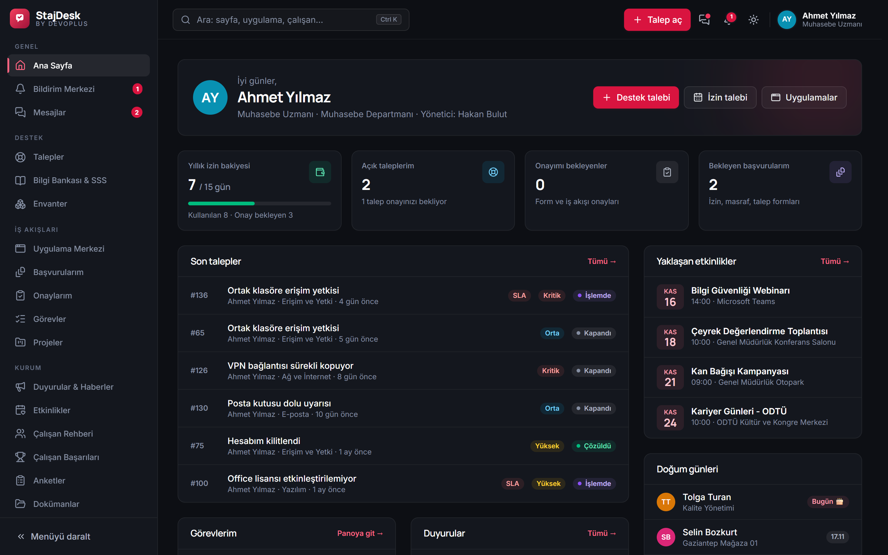
</p>

## StajDesk nedir?

StajDesk, bir perakende şirketinin merkez ofis, bölge ve mağaza çalışanlarının günlük işlerini tek
portalda toplar. Bir çalışan arızayı bildirir, izne çıkar, ciro girer, vardiya değiştirir; talep doğru
ekibe kendiliğinden yönlenir, onay sırası kimdeyse ona düşer, sonuç e-postayla ve **anında**
ekrana gelir.

GLPI'nin talep yönetimi yaklaşımını temel alır ve onu modern bir arayüz ile üç ilke üzerine yeniden kurar:

1. **Kurallar sunucudadır.** Arayüz yalnızca gösterir; yetki, görünürlük, izin bakiyesi, ciro
   tutarlılığı ve vardiya çakışması API'de denetlenir. Ön yüz atlansa da kural çiğnenemez.
2. **Hiçbir olay kaybolmaz.** Bildirimler veritabanıyla aynı işlemde *outbox*'a yazılır, RabbitMQ
   üzerinden Worker'a gider. Kuyruk ya da Worker kapalıyken üretilen olaylar sonra işlenir.
3. **Depoda sır yok.** Parola, anahtar ve gerçek kurum verisi depoya girmez; sistem eksik ya da
   örnek değerle açılmayı reddeder.

> **Demo ortamıdır.** Kullanıcılar, mağazalar ve bölgeler kurgusaldır. E-postalar geliştirmede
> dışarı çıkmaz (Mailpit). Canlıya almadan önce [SECURITY.md](SECURITY.md) dosyasını okuyun.

## Ekran görüntüleri

<table>
  <tr>
    <td width="50%">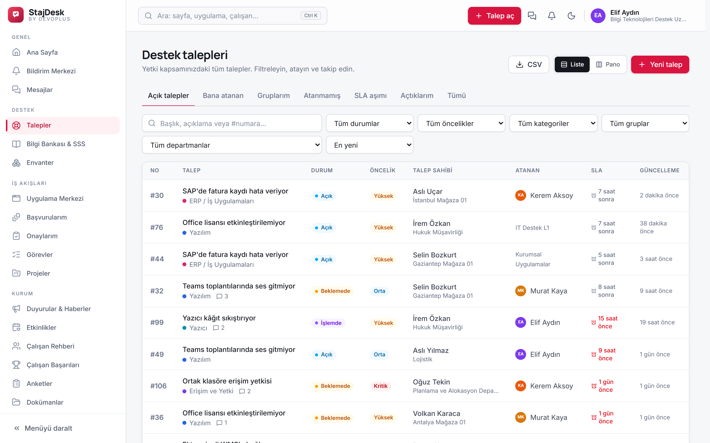</td>
    <td width="50%">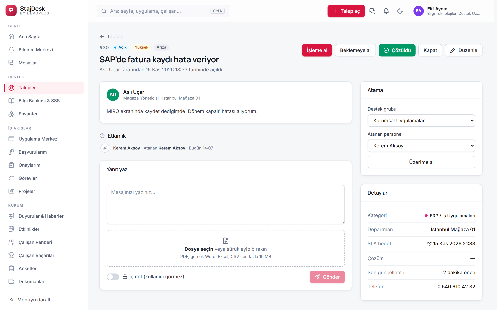</td>
  </tr>
  <tr>
    <td align="center">Talep kuyruğu: sekmeli görünümler, filtreler, SLA geri sayımı</td>
    <td align="center">Talep ayrıntısı: üstlen, işleme al, yanıtla, çöz</td>
  </tr>
  <tr>
    <td width="50%">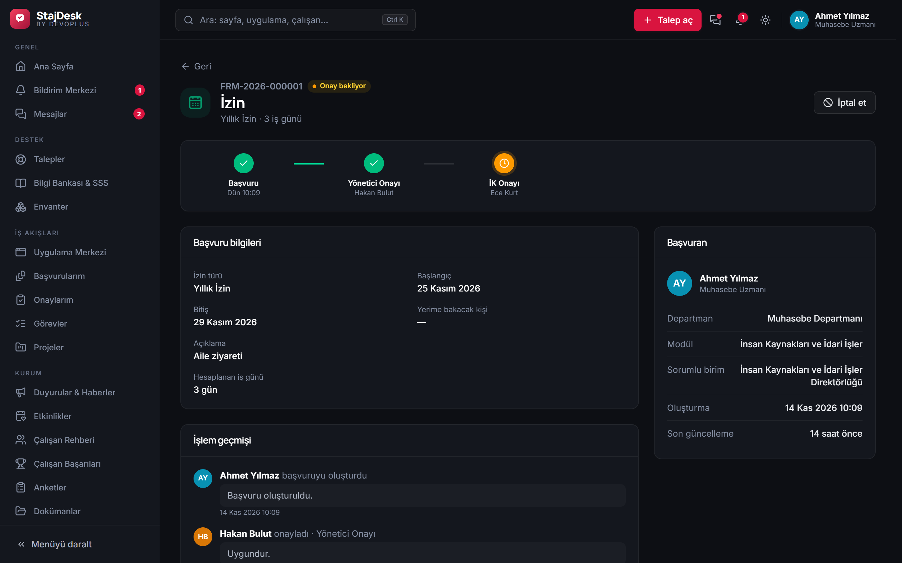</td>
    <td width="50%">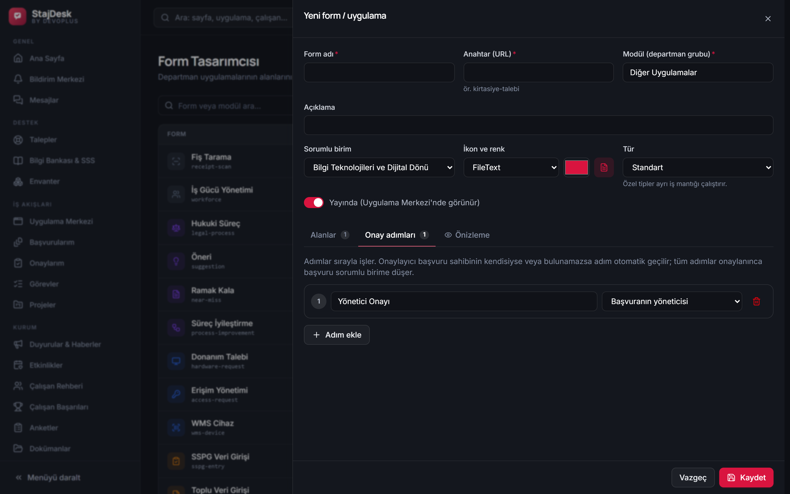</td>
  </tr>
  <tr>
    <td align="center">Çok adımlı onay: her adımın kimde olduğu görünür</td>
    <td align="center">Form tasarımcısı: kodsuz yeni uygulama ve onay zinciri</td>
  </tr>
  <tr>
    <td width="50%">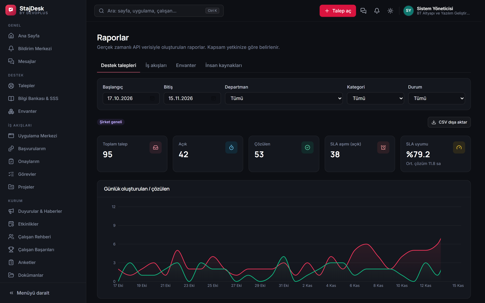</td>
    <td width="50%">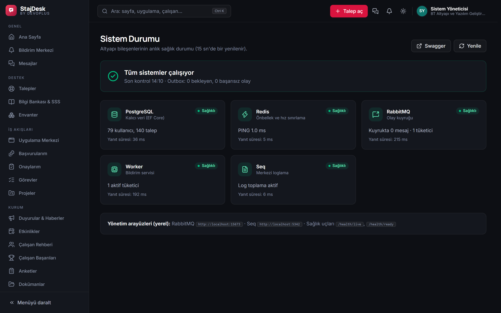</td>
  </tr>
  <tr>
    <td align="center">Raporlar: filtrelenebilir, CSV dışa aktarım</td>
    <td align="center">Sistem durumu: altyapının canlı sağlık kontrolü</td>
  </tr>
  <tr>
    <td width="50%">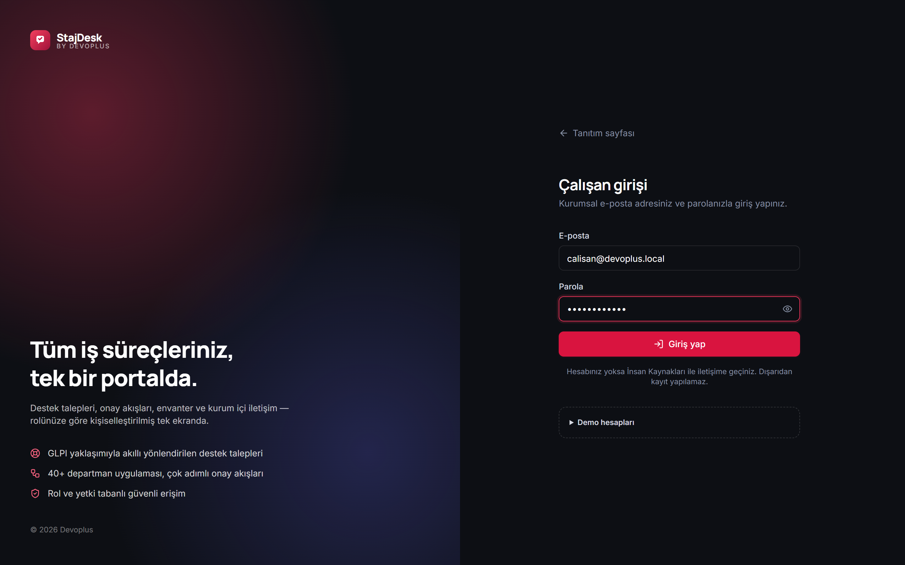</td>
    <td width="50%">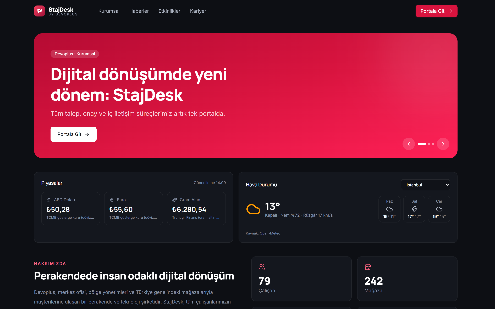</td>
  </tr>
  <tr>
    <td align="center">Giriş: parola + e-postaya gelen 6 haneli kod</td>
    <td align="center">Genel site: TCMB kurları, gram altın, hava durumu</td>
  </tr>
</table>

<p align="center">
  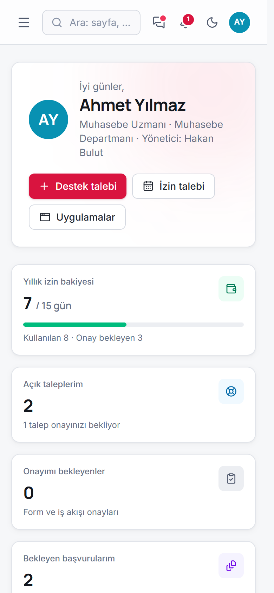
  &nbsp;&nbsp;
  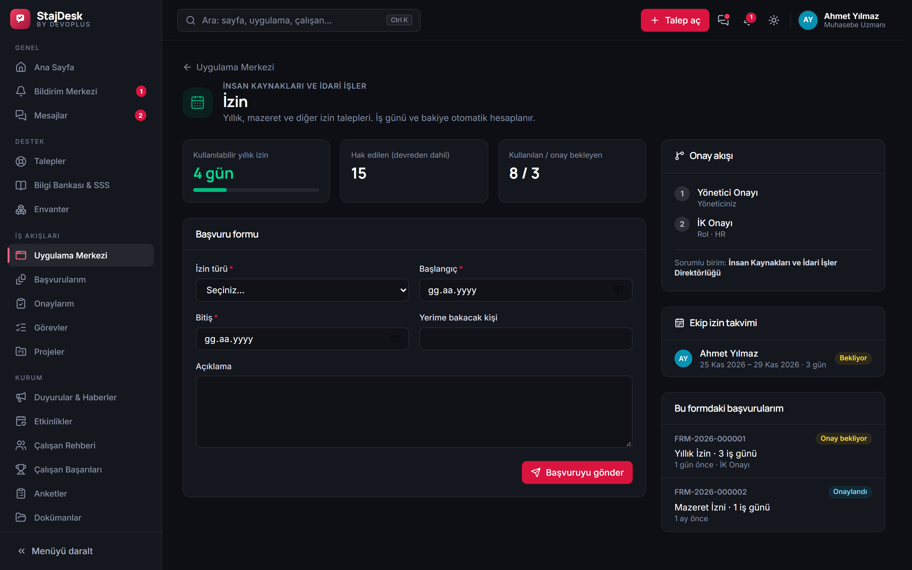
</p>
<p align="center"><sub>375 px'ten masaüstüne her ekran taşmadan çalışır (uçtan uca testlerle denetlenir) · açık ve koyu tema</sub></p>

Görüntüler gerçek arayüzden, kurgusal demo verisiyle
[`frontend/e2e/screenshots/readme.shots.ts`](frontend/e2e/screenshots/readme.shots.ts) tarafından alınır
(`npm run screenshots`).

## Hızlı başlangıç

Gerekenler: **Docker** (Compose v2) ve **Node.js 20+** (yalnızca gizli değerleri üretmek için).

```bash
node scripts/setup-secrets.mjs   # .env: rastgele parolalar ve JWT anahtarı (demo parolasını bir kez yazdırır)
docker compose up -d --build
```

İlk açılış şemayı kurar ve boş veritabanını demo verisiyle doldurur.

| Ne | Adres |
|---|---|
| **Portal** | http://localhost:3100 |
| **E-postalar (Mailpit)** — giriş kodu burada | http://localhost:8126 |
| API belgesi (Swagger) | http://localhost:3100/swagger |
| Günlükler (Seq) | http://localhost:5342 |
| Kuyruklar (RabbitMQ) | http://localhost:15673 |
| Sağlık | http://localhost:3100/health/ready |

Yönetim arayüzleri ve altyapı yalnızca bu bilgisayardan açılır; ağdan yalnızca portal erişilebilir.
Canlı ortam için HTTPS katmanı: [docs/guides/deployment.md](docs/guides/deployment.md) · Telefondan denemek: [docs/guides/phone.md](docs/guides/phone.md)

### Demo hesapları

Parola: `.env` içindeki `SEED_DEFAULT_PASSWORD`. Parolanın ardından hesabın e-postasına **6 haneli
doğrulama kodu** gider; kodu Mailpit'te görürsünüz (giriş ekranında bağlantısı vardır).

| E-posta | Rol | Ne görür |
|---|---|---|
| `calisan@devoplus.local` | Çalışan | Kendi talepleri, izin/masraf başvuruları, zimmetli cihazlar |
| `mudur@devoplus.local` | Departman yöneticisi | Ekip onayları, departman talepleri ve raporları |
| `it.destek@devoplus.local` | IT destek | Talep kuyruğu, envanter, hesap onayları |
| `ik.uzman@devoplus.local` | İK | Hesap talebi, izin bakiyeleri, içerik ve anketler |
| `superadmin@devoplus.local` | Süper yönetici | Tüm yönetim ekranları, rol/izin matrisi, sistem durumu |
| `ceo@devoplus.local` | CEO | Şirket geneli raporlar |
| `magaza.yonetici@devoplus.local` | Mağaza müdürü | Mağaza personeli onayları |
| `yeni.personel@devoplus.local` | Yeni çalışan | İlk girişte zorunlu parola belirleme |

Demoyu adım adım nasıl göstereceğiniz: [docs/guides/demo.md](docs/guides/demo.md)

## Neler çalışıyor

| Alan | Çalışıyor |
|---|---|
| **Destek talepleri** | Açık → İşlemde → Beklemede → Çözüldü → Kapandı. Öncelik bazlı SLA ve geri sayım, grup/kişi ataması, iç not, dosya eki, tam geçmiş, liste ve kanban görünümü, CSV dışa aktarım |
| **Otomatik yönlendirme** | Kategori, departman, anahtar kelime ve öncelik koşullarıyla gruba/kişiye/önceliğe yönlendirme; kuralı kaydetmeden deneme aracı |
| **Bilgi bankası** | Makale ve SSS, "yararlı" oyu, görüntülenme sayısı |
| **Envanter** | Donanım ve yazılım lisansı, zimmet/iade geçmişi, garanti takibi, kurulum sayısı |
| **Form ve onay motoru** | Kodsuz form tasarımcısı (12 alan tipi, kişi seçici dahil). Onaylayıcı: başvuranın yöneticisi, departman yöneticisi, rol, belirli kişi, sorumlu birim veya **formda seçilen kişi**. Onaylayıcı başvuranın kendisiyse adım kendiliğinden geçilir |
| **İzin** | Kıdeme göre hak ediş, iş günü ve resmî tatil hesabı, bakiye ve çakışma kontrolü, onayda bakiyeden düşme, ekip takvimi |
| **Avans / masraf** | Yönetilebilir tutar limitleri; limiti aşan başvuru sunucuda reddedilir |
| **Ciro** | Yalnızca açık mağazalar, nakit + kart = toplam kontrolü, aynı mağaza/gün için mükerrer engeli, ortalama sepet, 30 günlük panel ve mağaza sıralaması |
| **Vardiya** | 60 güne kadar ileri tarih, izinli güne ve aynı güne ikinci talep engeli; takas edilen kişi aynı departmandan olmalı ve **önce onun onayı** alınır |
| **Güvenlik** | Parolalar PBKDF2 (100.000 tekrar) ile özetlenir; canlıda HTTPS + HSTS, sıkı içerik güvenlik politikası (CSP), altyapı servisleri parolalı ve dışarıya kapalı. Ayrıntı: [şifreleme özeti](SECURITY.md#şifreleme-özeti) |
| **Giriş ve hesap** | Dışarıdan kayıt yok: İK talep eder → IT onaylar → geçici parola → ilk girişte zorunlu değişiklik. E-posta doğrulama kodlu iki adımlı giriş, 5 dk'da 5 hatalı denemede `429` |
| **Yetki** | 10 sistem rolü, izin matrisi; görünürlük veri sorgusunda uygulanır (talep, başvuru, dosya, doküman, zimmet) |
| **Bildirim** | Uygulama içi kayıt + SignalR ile anlık sayaç ve bildirim + SMTP e-posta. Anlık bağlantı koparsa arayüz periyodik sorguya döner |
| **İletişim** | Duyuru, etkinlik ve katılım, doğum günleri, çalışan başarıları, anonim anket, mesajlaşma, doküman, iş ilanı, nöbetçi, mağazalar, proje ve görev panosu |
| **Raporlar** | Talep, iş akışı, envanter, İK; tarih/departman/kategori/durum filtresi, CSV |
| **Genel site** | Yönetilebilir banner'lar, herkese açık haberler ve ilanlar; **gerçek** TCMB kurları, gram altın ve hava durumu. Kaynak erişilemezse değer uydurulmaz, hata gösterilir |
| **Arayüz** | Açık/koyu tema, komut paleti (Ctrl K), Escape ile katmanlı pencere kapatma, 375 px'e kadar duyarlı düzen |

**Henüz yok:** Ciro, Vardiya, İzin, Avans ve Masraf dışındaki 38 departman uygulaması ortak form +
onay motoruyla çalışır, kendine özel hesaplama içermez. Kurumsal dizin (LDAP/Entra ID) entegrasyonu ve
nesne depolama (S3) yoktur; dosyalar Docker biriminde tutulur. Diskteki veri uygulama düzeyinde
şifrelenmez; sunucu disk şifrelemesi önerilir ([SECURITY.md](SECURITY.md#şifreleme-özeti)).

## Mimari

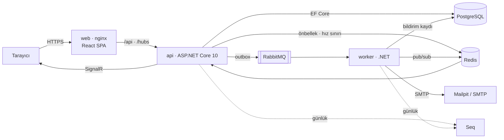

**Bağımlılık yönü içeri doğrudur:** `Domain` hiçbir şeye bağımlı değildir, `Infrastructure` yalnızca
`Domain`'e bakar, `Api` ve `Worker` en dıştadır. Bu kural yalnızca belgede yazmaz:
[`ArchitectureTests`](backend/tests/StajDesk.Tests/ArchitectureTests.cs) kuralı çiğneyen kodda kırılır.

**Açık/kapalı iş akışı motoru:** `WorkflowService` form türünden bağımsızdır. İzin, limit, ciro ve
vardiya kuralları kendi `IFormKindHandler` sınıflarındadır; yeni tür eklemek motoru değiştirmez.

Ayrıntılar: [Mimari](docs/architecture/overview.md) · [Veri modeli](docs/architecture/data-model.md) ·
[Karar kayıtları](docs/architecture/decisions/README.md) · [API](docs/api/README.md) ·
[Güvenlik](SECURITY.md)

### Klasörler

```text
backend/
├── src/
│   ├── StajDesk.Domain/          saf iş kuralları, bağımlılığı yok
│   │   ├── Common/               Entity, DomainException, izin kodları, roller
│   │   ├── Helpdesk/  Inventory/  Organization/  Workflow/  Collaboration/
│   ├── StajDesk.Infrastructure/  EF Core, migration'lar, outbox, RabbitMQ, e-posta, seed
│   ├── StajDesk.Api/
│   │   ├── Common/               Http/ · Security/ · Caching/ · Storage/ · Realtime/ · Messaging/
│   │   └── Features/<Alan>/      <Ad>Controller.cs · <Ad>Service.cs · Contracts.cs · Validators.cs
│   └── StajDesk.Worker/          kuyruk tüketicisi, Notifications/Channels/ (uygulama içi, anlık, e-posta)
└── tests/StajDesk.Tests/         birim, iş akışı ve mimari testleri

frontend/
├── src/
│   ├── components/               ortak arayüz parçaları, düzen, form alanları
│   ├── lib/                      API istemcisi, sorgular, form şeması, anlık bağlantı
│   ├── store/                    oturum ve arayüz durumu (Zustand)
│   └── pages/                    tickets/ · workflow/ · admin/ · comms/ · inventory/ · …
└── e2e/                          Playwright uçtan uca testleri ve README ekran görüntüleri

docs/                             mimari, karar kayıtları, API, rehberler, görseller
scripts/setup-secrets.mjs         yerel gizli değerleri üretir
```

Her C# dosyasında tek bir tip bulunur; bir alanın controller'ı, servisi, sözleşmeleri ve doğrulayıcıları
aynı klasördedir.

## Teknoloji

| Katman | Teknoloji |
|---|---|
| Arayüz | React 19, TypeScript, Vite, Tailwind CSS 4, React Router, TanStack Query, Zustand, React Hook Form + Zod, Recharts |
| API | ASP.NET Core 10 (LTS), EF Core 10 (Npgsql), FluentValidation, JWT + döndürmeli yenileme jetonu, OpenAPI |
| Veri | PostgreSQL 17 · **Önbellek:** Redis 7 · **Kuyruk:** RabbitMQ 4 (outbox, dead-letter) |
| Arka plan | .NET Worker Service: uygulama içi, SignalR ve SMTP bildirim kanalları |
| Gözlem | Serilog → Seq, sağlık uçları, sistem durumu ekranı |
| Altyapı | Docker Compose, Caddy (HTTPS, canlı katman), GitHub Actions (CI + ghcr.io imajları) |

## Testler

```bash
cd backend && dotnet test        # 51 xUnit: talep, iş akışı, ciro/vardiya, doğrulama kodu, mimari kuralları
cd frontend && npm test          # 22 Vitest: form şeması, biçimlendirme, yetki, dinamik form
cd frontend && npm run e2e       # 21 Playwright: çalışan sisteme karşı uçtan uca
```

Uçtan uca testler gerçek girişi (e-posta kodu Mailpit'ten okunur), **7 rol × 40 sayfa** taramasını,
telefon genişliğinde taşmayı, talep/izin/ciro/vardiya akışlarını, anlık bildirimi ve kaydırma
davranışını denetler. Her push'ta CI; derleme (uyarı = hata), testler, lint ve gizli bilgi taraması
çalıştırır. Ayrıntı: [docs/guides/testing.md](docs/guides/testing.md)

## Geliştirme

```bash
node scripts/setup-secrets.mjs                              # .env + appsettings.Local.json
docker compose up -d postgres redis rabbitmq seq mailpit    # yalnızca altyapı
cd backend && dotnet run --project src/StajDesk.Api --launch-profile http   # http://localhost:5100
cd backend && dotnet run --project src/StajDesk.Worker
cd frontend && npm install && npm run dev                   # http://localhost:5173
```

Ayarlar, kurum verisini yükleme ve yedekleme: [docs/guides/](docs/README.md#rehberler)

## Docker imajları

Her sürümde GitHub Container Registry'ye gönderilir:

```bash
docker pull ghcr.io/toygarkeskin/stajdesk-api:latest
docker pull ghcr.io/toygarkeskin/stajdesk-worker:latest
docker pull ghcr.io/toygarkeskin/stajdesk-web:latest
```

## Katkı

Değişiklik yapacaklar için yol gösterici: [CONTRIBUTING.md](CONTRIBUTING.md): katman kuralları, yeni
form türü ve yeni alan nasıl eklenir, sık düşülen tuzaklar. Değişiklik geçmişi: [CHANGELOG.md](CHANGELOG.md)

## Geliştirici

**Toygar Keskin** · Devoplus staj projesi
