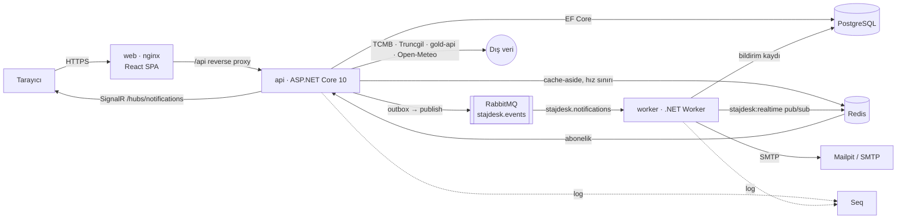
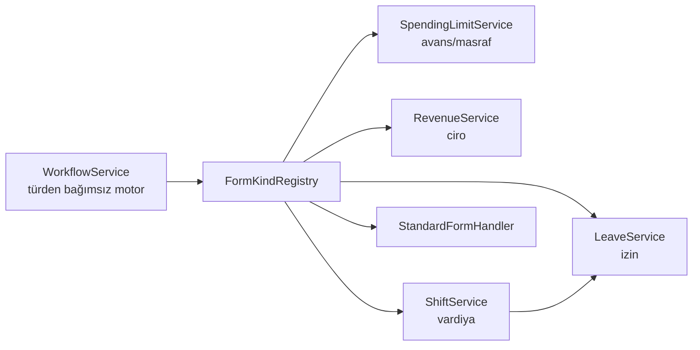

# Mimari

## Katmanlar

| Proje | Sorumluluk | Bağımlılık |
|---|---|---|
| `StajDesk.Domain` | Varlıklar, enum'lar, saf iş kuralları (`TicketRules`, `LeaveRules`, `RoutingRule.Matches`, izin kodları) | — |
| `StajDesk.Infrastructure` | `AppDbContext`, Fluent API eşlemeleri, migration'lar, `AuditInterceptor`, outbox (`IEventBus`), RabbitMQ yayıncısı, seed | Domain |
| `StajDesk.Api` | Controller → Servis katmanı (feature klasörleri), DTO'lar, FluentValidation, JWT, izin politikaları, Redis, dosya depolama, dış veri | Infrastructure |
| `StajDesk.Worker` | RabbitMQ tüketicisi, olay → bildirim eşleme, bildirim kanalları | Infrastructure |

Controller'larda iş mantığı yoktur; servisler `UserContext` alır (HttpContext'e bağımlı değildir) ve birim testlerde bellek-içi veritabanıyla test edilir.

## İstek akışı

1. `ExceptionMiddleware` → tüm hatalar `{ success, data, message, errors, code }` zarfına çevrilir.
2. JWT doğrulama (`role` ve `perm` talepleri) → `PasswordChangeGateMiddleware` (ilk girişte parola belirlenmeden yalnızca `/api/auth` açıktır).
3. `[HasPermission("…")]` politikası → izin kodu sunucuda kontrol edilir.
4. `ValidationFilter` → ilgili FluentValidation doğrulayıcısı.
5. Servis; görünürlük kuralları (ör. talep: kendi / atanan / grubu / departman / tümü) veri sorgusuna eklenir.

## Olay akışı (RabbitMQ)

- Servisler olayı doğrudan göndermez; `IEventBus.Enqueue` olayı **aynı veritabanı işleminde** `outbox_messages` tablosuna yazar (transactional outbox). RabbitMQ geçici olarak kapalı olsa bile olay kaybolmaz.
- `OutboxPublisherService` 2 sn'de bir bekleyen olayları **kalıcı (persistent)** mesaj olarak `stajdesk.events` topic exchange'ine yayınlar (publisher confirms açık).
- `stajdesk.notifications` kalıcı kuyruğu `ticket.*`, `workflow.*`, `account.*`, `notify.*` anahtarlarına bağlıdır; hatalı mesajlar bir kez yeniden denenir, sonra `stajdesk.notifications.dlq` dead-letter kuyruğuna düşer.
- Worker manuel `ack` kullanır; Worker kapalıyken gelen mesajlar kuyrukta bekler. Bildirimler `(SourceEventId, UserId)` benzersiz indeksiyle idempotenttir.
- Kanal soyutlaması (`INotificationChannel`), sırayla:
  1. `InAppChannel` — PostgreSQL'e kalıcı kayıt (idempotent).
  2. `RealtimeChannel` — Redis `stajdesk:realtime` kanalına yayın. API'deki `RealtimeRelayService` bu kanalı dinler ve `NotificationHub` üzerinden yalnızca ilgili kullanıcının (`sub`) bağlantılarına iletir; API birden fazla örnekle çalışsa da her örnek kendi bağlantılarına iletir. Arayüz bildirim gelince sayaçları/listeleri anında yeniler ve toast gösterir; bağlantı koparsa periyodik sorguya döner.
  3. `EmailChannel` — MailKit ile SMTP (geliştirmede Mailpit). Yalnızca aksiyon gerektiren türler (onay, talep, hesap, uyarı, sonuç) gönderilir. SMTP hatası olayı tekrar işletmez; uygulama içi bildirim zaten kaydedilmiştir.

| Olay | Üretildiği yer | Bildirim alanlar |
|---|---|---|
| `ticket.created` | Talep oluşturma | Talep sahibi (alındı), atanan kişi, grup üyeleri |
| `ticket.status_changed` | Durum değişimi | Talep sahibi, atanan |
| `ticket.assigned` | Atama | Atanan, talep sahibi |
| `ticket.commented` | Yorum | Talep sahibi (iç not hariç), atanan / grup |
| `workflow.step_pending` | Başvuru / önceki adım onayı | Mevcut adımın onaylayıcıları |
| `workflow.approved/rejected/completed/cancelled/commented` | Karar | Başvuran, sorumlu |
| `account.request_created/account_created/account_deactivated` | Hesap süreçleri | IT, İK |
| `notify.direct` | Duyuru, takdir, mesaj, görev, zimmet, anket | Belirtilen alıcılar |

## Redis kullanımı

| Anahtar | Süre | Geçersiz kılma |
|---|---|---|
| `stajdesk:lookup:categories/departments/titles` | 60 sn – 5 dk | İlgili kayıt değişince |
| `stajdesk:stats:dashboard:{userId}` | 30 sn | Talep değişikliklerinde `stajdesk:stats:*` |
| `stajdesk:public:home/market/weather` | 2–20 dk (kaynak hatası içeren piyasa sonucu 1 dk) | İçerik değişince |
| `stajdesk:realtime` (pub/sub kanalı) | — | Worker → API anlık bildirim köprüsü |
| `stajdesk:ratelimit:login:{email}` | 5 dk | Başarılı girişte |

Redis kapalıysa API çalışmaya devam eder (önbelleksiz, veritabanından okur; hız sınırlama geçici olarak devre dışı kalır ve uyarı loglanır).

## İş akışı motoru

- Türe özgü kurallar `IFormKindHandler` arayüzündedir: `ValidateAsync` (gönderim), `OnApprovedAsync` (onay sonrası), `UserContextAsync` (bakiye/limit bağlamı), `PrepareFieldsAsync` (ör. mağaza listesi), `ExtraFields` (detayda hesaplanan alanlar). Yeni tür eklemek motoru değiştirmeyi gerektirmez.

- `FormDefinition` alanları ve adımları `jsonb` sütunlarında tutulur; form tasarımcısı bunları düzenler.
- Onaylayıcı çözümleme: `Manager` → başvuranın yöneticisi, `DepartmentManager`, `ResponsibleDepartment` → formun sahibi birimin yöneticisi, `Role`, `User`. Bulunamazsa Admin'e düşer; onaylayıcı başvuranın kendisiyse adım **otomatik atlanır** (kayda geçer).
- Tüm adımlar onaylanınca başvuru `Approved` olur ve sorumlu birim yöneticisine atanır; işlem yapılınca `Completed` işaretlenir.
- `FieldUser` onaylayıcı tipi: onaylayıcı, formdaki `user` tipli bir alanda seçilen çalışandır (ör. vardiya takası). Alan boşsa adım atlanır, yöneticilere düşmez.
- `Kind` alanı özel iş mantığı bağlar: `leave` (iş günü, resmî tatil, çakışma, bakiye; onayda bakiyeden düşer), `expense` / `advance` (limit kontrolü), `revenue` (mağaza doğrulama, nakit + kart = toplam, mükerrer engeli, ortalama sepet; `/api/revenue/summary`), `shift` (tarih aralığı, izin çakışması, aynı güne ikinci talep, takas kişisi aynı departman; `/api/shifts`).
- Mevcut veritabanında sonradan özel tür kazanan sistem formları (Ciro, Vardiya) açılışta yükseltilir; yalnızca hâlâ `standard` olanlara dokunulur.

## Ölçeklenebilirlik notları

- API durumsuzdur (refresh token veritabanında, önbellek Redis'te) — yatayda çoğaltılabilir.
- Worker birden fazla örnekle çalıştırılabilir (prefetch 10, idempotent işleme).
- Dosyalar `uploads` volume'ünde; üretimde nesne depolamaya (S3/MinIO) taşınabilir (`FileStorage` tek noktadır).
